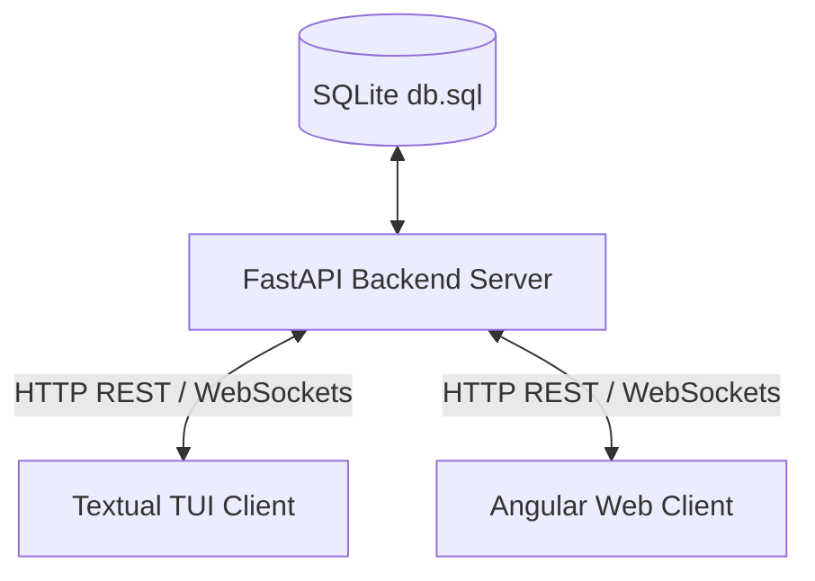

# Project Structure Proposal: Goose

This document proposes a multi-client architecture for the Goose application. The goal is to establish **FastAPI** as the single source of truth for database access, with both the **Textual TUI** (for development) and the **Angular Web App** (for production) acting as client applications consuming backend API endpoints.

---

## Proposed Directory Layout

```
goose/
├── backend/                   # FastAPI REST API & Database server
│   ├── app/                   # Server codebase
│   │   ├── api/               # API Router and Endpoints (v1)
│   │   │   ├── endpoints/     # Feature-specific endpoints (stocks, prices)
│   │   │   └── deps.py        # Database dependencies (get_db session)
│   │   ├── core/              # Global config, settings, db engine setup
│   │   ├── crud/              # DB operations (Create, Read, Update, Delete)
│   │   ├── models/            # SQLModel database tables
│   │   ├── schemas/           # Pydantic schemas (Request/Response validation)
│   │   ├── services/          # Third-party integrations (yfinance, background workers)
│   │   └── main.py            # FastAPI entry point & ASGI config
│   ├── migrations/            # Alembic migrations database schema versioning
│   ├── alembic.ini            # Alembic database migration config
│   ├── pyproject.toml         # Backend dependencies (fastapi, sqlmodel, yfinance, alembic)
│   └── README.md
│
├── tui/                       # Terminal User Interface (Development Client)
│   ├── src/                   # TUI client codebase
│   │   ├── api_client.py      # HTTP client wrapper (using httpx) to call backend API
│   │   ├── widgets/           # Textual UI custom component widgets
│   │   ├── screens/           # TUI Screen layouts (Dashboard, Settings, etc.)
│   │   └── main.py            # Textual TUI launcher
│   ├── pyproject.toml         # TUI dependencies (textual, httpx)
│   └── README.md
│
├── web/                       # Angular Web Application (Production Client)
│   ├── src/                   # Angular frontend source code
│   │   ├── app/
│   │   │   ├── components/    # Reusable components
│   │   │   ├── services/      # API services interacting with the backend API
│   │   │   └── models/        # Angular data models
│   │   └── assets/
│   ├── angular.json           # Angular build configuration
│   ├── package.json           # Frontend Node dependencies (Angular CLI, HttpClient)
│   └── README.md
│
├── db.sql                     # Shared SQLite database (configured/located via env var)
└── README.md                  # Project root README
```

---

## Architectural Workflow



### 1. Database & Server (`backend/`)
- **FastAPI** is the exclusive manager of `db.sql`. 
- No client directly writes to or reads from the SQLite file. This prevents file-locking issues (`database is locked`) and ensures business/validation rules are consistently enforced.
- **SQLModel** maps database tables and provides query capabilities.
- Backend runs as an independent daemon or process (e.g. `uvicorn app.main:app --reload`).

### 2. Terminal UI Client (`tui/`)
- Built using **Textual**.
- Communicates with FastAPI over **HTTP** (via `httpx`).
- When a user interacts with the TUI, it fires requests to the backend API (`GET /stocks`, `POST /stocks/update`), processes the JSON payload, and updates the terminal view.
- Keeping this in a separate directory cleanses the production backend code of Terminal/UI dependencies.

### 3. Angular Web Client (`web/`)
- Built using **Angular**.
- Interacts with the backend using Angular's native `HttpClient` to consume the same REST endpoints.
- Simplifies cross-origin requests (CORS) configured on the FastAPI server.

---

## Advantages of this Structure

1. **Separation of Concerns:** Backend focuses on business logic, scheduled yfinance updates, and query optimization. UI clients focus purely on presentation.
2. **Lean Dependencies:** Prevents production builds (like the future Web App) from carrying bulky python UI dependencies (like Textual) or vice-versa.
3. **API-First Development:** Building the TUI forces you to design clean, robust, and well-documented endpoints (with FastAPI's automatic `/docs` swagger page), which will then be ready to use when building the Angular application.
4. **Environment Portability:** Database queries can scale to PostgreSQL or MySQL in the backend core settings without modifying any frontend code.
