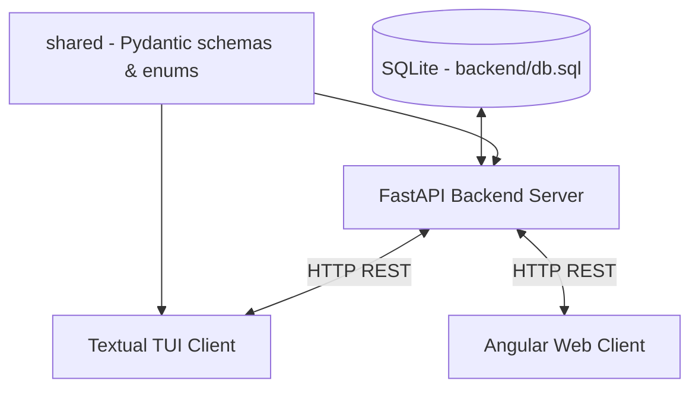

# Project Structure Proposal: Goose

This document proposes a multi-client architecture for the Goose application. The goal is to establish **FastAPI** as the single source of truth for database access, with both the **Textual TUI** (for development) and the **Angular Web App** (for production) acting as client applications consuming backend API endpoints.

---

## Proposed Directory Layout

```
goose/
├── shared/                    # Shared Python package (API contract)
│   ├── schemas/               # Pydantic response/request models
│   │   ├── stock.py           # StockResponse, StockCreate, etc.
│   │   └── price.py           # StockPriceResponse, etc.
│   ├── enums.py               # Shared enums (Exchange, Currency, etc.)
│   └── pyproject.toml         # Minimal package definition (name: goose-shared)
│
├── backend/                   # FastAPI REST API & Database server
│   ├── app/                   # Server codebase
│   │   ├── api/               # API Router and Endpoints
│   │   │   ├── endpoints/     # Feature-specific endpoints (stocks, prices, targets)
│   │   │   └── deps.py        # Shared dependencies (get_db session injection)
│   │   ├── core/              # Global configuration
│   │   │   ├── config.py      # Env vars & settings (DATABASE_URL, SQL_ECHO, etc.)
│   │   │   └── database.py    # Engine & session factory (replaces dependencies.py)
│   │   ├── crud/              # Database operations (Create, Read, Update, Delete)
│   │   ├── models/            # SQLModel table definitions
│   │   ├── services/          # Third-party integrations (yfinance, background workers)
│   │   └── main.py            # FastAPI entry point & ASGI config
│   ├── migrations/            # Alembic migration scripts
│   ├── alembic.ini            # Alembic configuration
│   ├── db.sql                 # SQLite database file (server-only, not shared at root)
│   └── pyproject.toml         # Backend deps (fastapi, sqlmodel, yfinance, alembic, goose-shared)
│
├── tui/                       # Terminal User Interface (Development Client)
│   ├── api_client.py          # HTTP client wrapper (httpx) to call backend API
│   ├── widgets/               # Textual custom widget components
│   ├── screens/               # TUI screen layouts (Dashboard, Detail, etc.)
│   ├── main.py                # Textual TUI entry point
│   ├── goose.sh               # Shell script launcher
│   └── pyproject.toml         # TUI deps (textual, httpx, goose-shared)
│
├── web/                       # Angular Web Application (Production Client)
│   ├── src/
│   │   ├── app/
│   │   │   ├── components/    # Reusable Angular components
│   │   │   ├── services/      # Angular services (API calls via HttpClient)
│   │   │   └── models/        # TypeScript interfaces mirroring shared schemas
│   │   └── assets/
│   ├── angular.json           # Angular build configuration
│   ├── package.json           # Node dependencies
│   └── README.md
│
├── pyproject.toml             # uv workspace root — declares all workspace members
├── uv.lock                    # Single shared lock file for all Python packages
├── Makefile                   # Convenience commands to run backend, TUI, and web
└── README.md                  # Project root README
```

---

## Architectural Workflow



### 1. Shared Package (`shared/`)
- Contains **Pydantic schemas** (API request/response models) and **enums** shared between backend and TUI.
- Managed as a **uv workspace member** — no manual path hacking needed.
- The backend uses these schemas as FastAPI response models; the TUI uses them to parse and validate API responses.
- When building the Angular frontend, `shared/schemas/` serves as the **reference** for writing matching TypeScript interfaces.

### 2. Database & Server (`backend/`)
- **FastAPI** is the **exclusive** manager of `db.sql`.
- `db.sql` lives inside `backend/` — it is a server implementation detail; no client references its path directly.
- `core/config.py` reads `DATABASE_URL` and `SQL_ECHO` from environment variables.
- `core/database.py` creates the engine and session factory (consolidates the current `dependencies.py`).
- The server runs as an independent process: `uvicorn app.main:app --reload`
- Note: `backend/app/` has no `schemas/` folder — those live in `shared/` now.

### 3. Terminal UI Client (`tui/`)
- Built with **Textual**, runs as a standalone Python application.
- Has **no direct database access** — all data flows through the FastAPI backend via `httpx`.
- `api_client.py` is a thin wrapper that handles base URL, error handling, and response parsing using shared Pydantic schemas.
- Flat directory structure (no `src/` nesting) since this is not a distributed package.

### 4. Angular Web Client (`web/`)
- Built with **Angular**, communicates with the backend using `HttpClient`.
- TypeScript `models/` mirror the `shared/schemas/` Pydantic models for type safety end-to-end.
- CORS is configured on the FastAPI server to allow requests from the Angular dev server.

---

## uv Workspace Setup

A single `pyproject.toml` at the root declares all Python packages as workspace members. uv handles dependency resolution across all of them with one shared `uv.lock` file.

```toml
# goose/pyproject.toml  (root)
[tool.uv.workspace]
members = ["shared", "backend", "tui"]
```

```toml
# goose/shared/pyproject.toml
[project]
name = "goose-shared"
version = "0.1.0"
requires-python = ">=3.12"
```

```toml
# goose/backend/pyproject.toml
[project]
name = "goose-backend"
dependencies = [
    "goose-shared",   # resolved from workspace automatically
    "fastapi[standard]",
    "sqlmodel",
    "yfinance",
    "alembic",
]
```

```toml
# goose/tui/pyproject.toml
[project]
name = "goose-tui"
dependencies = [
    "goose-shared",   # same shared schemas, no duplication
    "textual",
    "httpx",
]
```

---

## Root `Makefile`

```makefile
.PHONY: backend tui web

backend:
	cd backend && uv run uvicorn app.main:app --reload

tui:
	cd tui && uv run python main.py

web:
	cd web && ng serve
```

---

## Advantages of this Structure

| Concern | Approach |
|---------|----------|
| Single source of truth for DB | Only `backend/` touches `db.sql` |
| Single source of truth for API contract | Pydantic schemas live in `shared/`, used by both backend and TUI |
| Lean dependencies | Each package has its own `pyproject.toml` |
| One lock file | uv workspace manages a single `uv.lock` at the root |
| API-first development | TUI forces well-designed endpoints before Angular is built |
| Portability | `DATABASE_URL` in `core/config.py` makes DB backend swappable |
| Developer experience | `Makefile` provides simple `make backend` / `make tui` commands |
