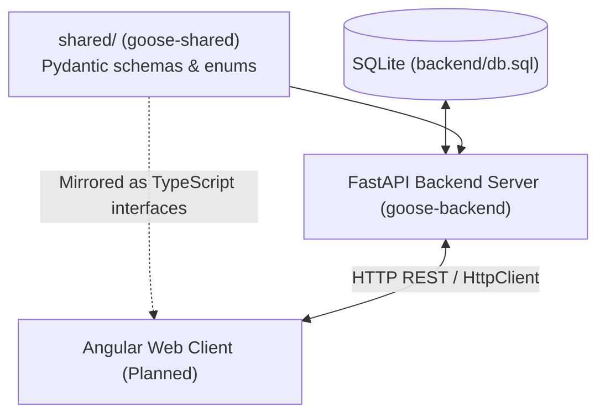

# Goose 🪿

**Goose** is a multi-client portfolio management, dividend investing, and stock analysis platform. It provides an API-first backend to track stock fundamentals, daily OHLCV prices, dividend distributions, and quantitative portfolio optimization models across US and Thai markets.

---

## Architecture Overview

Goose is built as an **API-first monorepo** using a unified **`uv` workspace**:
* **FastAPI Backend (`backend/`)**: The single source of truth for database access, business logic, and third-party data integrations (e.g. Yahoo Finance). Owns the SQLite database (`backend/db.sql`).
* **Shared Contract (`shared/`)**: Shared Pydantic schemas and enums used across backend and clients to ensure end-to-end data integrity.
* **Web UI (`web/`, Planned)**: An Angular single-page application for production web consumption, charts, and portfolio visualization.



---

## Directory Structure

```
goose/
├── docs/                      # Architectural & design specifications
│   ├── API_DESIGN.md          # Complete REST API specifications & synchronization pipeline
│   ├── DATABASE_DESIGN.md     # Relational schema, ER diagram, indexing, & SQLite config
│   ├── PROJECT_STRUCTURE.md   # System architecture and workspace layout
│   ├── TODO_EARNINGS_AND_ANALYST_RATINGS.md # Temporary feature backlog for sentiment tracking
│   └── CODE_REVIEW.md         # Historical backend audit and prioritized backlog
│
├── backend/                   # FastAPI REST API & Database server (goose-backend)
│   ├── app/
│   │   ├── api/               # REST API endpoints (/api/v1/stocks)
│   │   ├── core/              # Global config, SQLite engine, & market hours
│   │   ├── crud/              # Database queries (crud/stock.py)
│   │   ├── services/          # Batch sync pipeline (services/stock_sync.py)
│   │   └── main.py            # FastAPI ASGI entry point
│   ├── migrations/            # Alembic database migration scripts
│   ├── models.py              # SQLModel database tables (Stock, StockPrice, StockDividend)
│   ├── dependencies.py        # Re-export compatibility layer
│   └── pyproject.toml         # Backend package definition
│
├── shared/                    # Shared Pydantic data schemas & contracts (goose-shared)
│   ├── shared/
│   │   ├── schemas/           # Stock, Price, Dividend, and Sync response/request models
│   │   ├── enums.py           # Shared enumerations (Currency, Exchange)
│   │   └── __init__.py
│   └── pyproject.toml         # Shared package definition
│
├── experiment/                # Research & Algorithmic Prototyping
│   └── portfolio_optimization_idea.md  # Dividend & upside portfolio optimization proposal
│
├── typings/                   # Static type stubs for untyped libraries (yfinance)
├── .zed/settings.json         # Zed IDE workspace settings
├── pyrightconfig.json         # Pyright language server configuration
├── pyproject.toml             # Root uv workspace configuration
├── Makefile                   # Convenience commands for development & backup
└── README.md                  # Project overview (this file)
```

---

## Key Documentation

* 🚀 [**REST API Design (`docs/API_DESIGN.md`)**](docs/API_DESIGN.md): Detailed specifications for all `/api/v1` endpoints, JSON request/response payloads, query filters, and the incremental batch sync pipeline.
* 📐 [**Database Design (`docs/DATABASE_DESIGN.md`)**](docs/DATABASE_DESIGN.md): ER diagram, table schemas (`Stock`, `StockPrice`, `StockDividend`, `AnalystPriceTarget`), compound uniqueness constraints (`ticker x country`), and SQLite WAL configuration.
* 🏗️ [**Project Architecture (`docs/PROJECT_STRUCTURE.md`)**](docs/PROJECT_STRUCTURE.md): Detailed explanation of the multi-client decoupling, workspace structure, and packaging rationale.
* 💡 [**Portfolio Optimization Strategy (`experiment/portfolio_optimization_idea.md`)**](experiment/portfolio_optimization_idea.md): Quantitative framework for dividend yield and analyst target optimization, critical risk assessment, and phased backtesting roadmap.
* 🔍 [**Code Review & Backlog (`docs/CODE_REVIEW.md`)**](docs/CODE_REVIEW.md): Audit of legacy queries, N+1 optimization, and technical debt.

---

## Getting Started

### Prerequisites
* Python `>= 3.12`
* [`uv`](https://github.com/astral-sh/uv) (fast Python package and project manager)

### Installation & Setup

1. **Clone the repository**:
   ```bash
   git clone git@github.com:tame0001/goose.git
   cd goose
   ```

2. **Sync workspace dependencies**:
   ```bash
   make sync
   # or: uv sync
   ```

---

## Running the Application

### 1. Start the FastAPI Backend
```bash
make backend
# Server runs on http://127.0.0.1:8000
# Interactive Swagger docs: http://127.0.0.1:8000/docs
```

### 2. Database Backup
```bash
make backup
# Creates clean snapshot in .db_backup/ (goose_backup.db and goose_backup.sql)
```

### 3. Code Formatting & Linting
```bash
make lint
# Runs ruff check across all workspace packages
```
