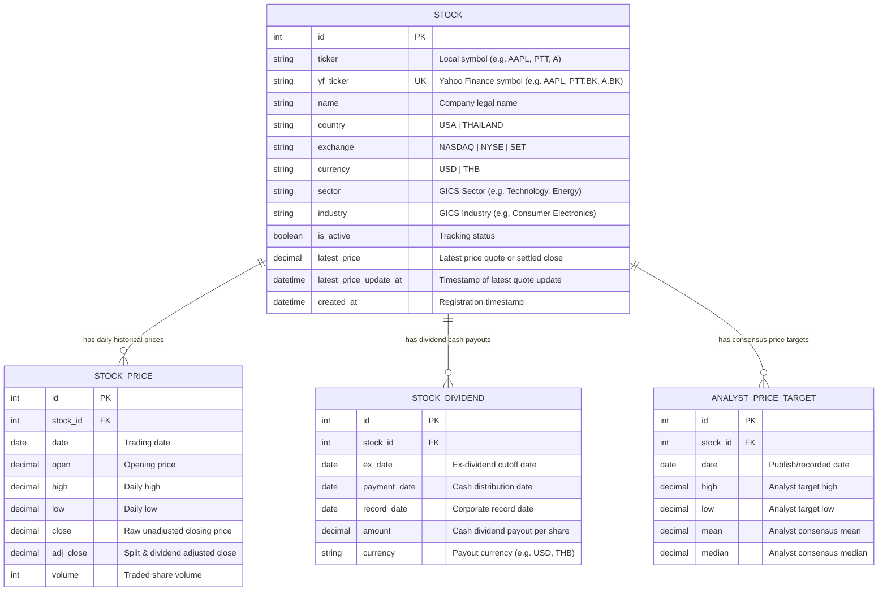

# Database Design Specification: Goose

This document details the database schema, relational structure, design rationale, and SQLite storage configuration for the **Goose** financial platform.

For the HTTP endpoints, request/response models, and sync pipeline details, see [**API Design Specification (`docs/API_DESIGN.md`)**](API_DESIGN.md).

---

## 1. Architectural Strategy: Database vs. API Schemas

In accordance with our multi-client architecture:
* **Database Models (`backend/models.py`)**: Defined via **SQLModel** (`table=True`). Owned strictly by the backend to manage SQLite persistence, indexing, migrations (Alembic), and relational integrity.
* **API Schemas (`shared/shared/schemas/`)**: Defined via **Pydantic** (`BaseModel`). Shared across the backend and Python TUI, and serving as the blueprint for Angular TypeScript interfaces (`.ts`).
* **Clients never connect directly to the database**. All client interaction flows through the FastAPI REST server. See [API_DESIGN.md](API_DESIGN.md).

---

## 2. Entity-Relationship (ER) Diagram

---

## 3. Database Schema Definitions

### A. `Stock` Table
The master registry of tracked companies across US and international markets.

| Column | Type | Constraints | Description |
| :--- | :--- | :--- | :--- |
| `id` | `INTEGER` | `PRIMARY KEY` | Auto-incrementing internal identifier. |
| `ticker` | `VARCHAR(10)` | `INDEX` | Local market symbol (e.g., `AAPL`, `PTT`, `A`). |
| `country` | `VARCHAR(20)` | `DEFAULT 'USA'` | Country of primary listing (`USA`, `THAILAND`). |
| `yf_ticker` | `VARCHAR(20)` | `UNIQUE, INDEX` | Globally unique Yahoo Finance symbol (`AAPL`, `PTT.BK`, `A.BK`). |
| `name` | `VARCHAR(255)` | `NOT NULL` | Full corporate name. |
| `exchange` | `VARCHAR(50)` | `NULLABLE` | Listing exchange (`NASDAQ`, `NYSE`, `SET`). |
| `currency` | `VARCHAR(10)` | `DEFAULT 'USD'` | Currency for pricing and cash flows (`USD`, `THB`). |
| `sector` | `VARCHAR(100)` | `NULLABLE` | GICS economic sector (used for portfolio sector caps). |
| `industry` | `VARCHAR(100)` | `NULLABLE` | GICS industry classification. |
| `is_active` | `BOOLEAN` | `DEFAULT TRUE` | Allows pausing price syncs without deleting historical data. |
| `latest_price` | `NUMERIC(10, 2)` | `NULLABLE` | Latest recorded price quote or settled closing price. |
| `latest_price_update_at` | `DATETIME` | `NULLABLE` | Timestamp of the latest price quote update. |
| `created_at` | `DATETIME` | `DEFAULT UTC` | Audit timestamp. |

* **Table Constraints**:
  * `UNIQUE (ticker, country)`: Prevents duplicate tickers within the same market, while permitting the same symbol across different countries (e.g., `A` in US vs. `A` in Thailand).
  * `UNIQUE (yf_ticker)`: Guarantees external data sync integrity.

---

### B. `StockPrice` Table
Daily time-series records of price action and market liquidity.

| Column | Type | Constraints | Description |
| :--- | :--- | :--- | :--- |
| `id` | `INTEGER` | `PRIMARY KEY` | Auto-incrementing record ID. |
| `stock_id` | `INTEGER` | `FOREIGN KEY (stock.id)` | Link to parent company. |
| `date` | `DATE` | `INDEX` | Market trading session date. |
| `open` | `NUMERIC(10, 2)` | `NOT NULL` | Daily opening price. |
| `high` | `NUMERIC(10, 2)` | `NOT NULL` | Session high. |
| `low` | `NUMERIC(10, 2)` | `NOT NULL` | Session low. |
| `close` | `NUMERIC(10, 2)` | `NOT NULL` | Raw unadjusted closing price. |
| `adj_close` | `NUMERIC(10, 2)` | `NOT NULL` | Split- and dividend-adjusted closing price. |
| `volume` | `BIGINT` | `DEFAULT 0` | Total traded shares in session. |

* **Table Constraints & Indexes**:
  * `UNIQUE (stock_id, date)`: Enforces idempotency; prevents duplicate rows during re-runs of historical backfills.
  * `INDEX (stock_id, date)`: Optimizes range scans and latest-price lookups.

---

### C. `StockDividend` Table
Discrete corporate cash dividend distributions.

| Column | Type | Constraints | Description |
| :--- | :--- | :--- | :--- |
| `id` | `INTEGER` | `PRIMARY KEY` | Record ID. |
| `stock_id` | `INTEGER` | `FOREIGN KEY (stock.id)` | Link to parent company. |
| `ex_date` | `DATE` | `INDEX` | Cutoff date for dividend entitlement. |
| `payment_date` | `DATE` | `NULLABLE` | Date cash was distributed to shareholders. |
| `record_date` | `DATE` | `NULLABLE` | Corporate book-close date. |
| `amount` | `NUMERIC(10, 2)` | `NOT NULL` | Cash amount per share. |
| `currency` | `VARCHAR(10)` | `DEFAULT 'USD'` | Dividend currency. |

* **Table Constraints & Indexes**:
  * `UNIQUE (stock_id, ex_date)`: Guarantees each dividend event is recorded only once per stock.
  * `INDEX (stock_id, ex_date)`: Accelerates multi-year dividend growth and payout ratio calculations.

---

## 4. Key Design Decisions & Trade-Offs

1. **Why `(ticker, country)` Compound Uniqueness?**
   * Multi-market tracking introduces symbol collision (e.g., ticker `A` is *Agilent Technologies* in the US, but *Areeya Property* in Thailand).
   * Combining `(ticker, country)` allows human users to read simple symbols (`A`) while guaranteeing database integrity.
   * `yf_ticker` remains globally unique (`A` vs `A.BK`) and is used as the external synchronization key.

2. **Why a Dedicated `StockDividend` Table?**
   * Dividends occur 1 to 4 times a year, whereas prices occur ~252 trading days a year.
   * Merging dividend columns into daily prices wastes space and complicates corporate actions (e.g., special dividends, payment dates vs. ex-dates).
   * A separate table makes calculating consecutive years of dividend growth, dividend safety, and yield history straightforward and performant.

3. **Why `adj_close` alongside `close`?**
   * Raw `close` is necessary for reflecting exact historical trading quotes.
   * `adj_close` adjusts backwards for stock splits (e.g., 2-for-1 or 10-for-1 splits) and dividend distributions. Without `adj_close`, historical return calculations and technical indicators produce false drops.

4. **Why `latest_price` on the `Stock` Table (Intraday vs. Settled History)?**
   * The `stock_price` table strictly stores **settled, finalized daily historical bars** after market close. Intraday partial candles (incomplete volumes, evolving highs/lows) are never written to `stock_price`.
   * Storing `latest_price` and `latest_price_update_at` directly on `Stock` enables real-time quote updates during active market hours with a single row update, eliminating database write churn and query joins.

5. **Hardcoded Market Hours & Future Expansion Note**:
   * Currently, Goose focuses exclusively on two markets:
     * **Thailand (SET)**: `Asia/Bangkok` (UTC+7), `10:00 - 16:30` ICT (lunch break ignored).
     * **United States (NYSE / NASDAQ)**: `America/New_York` (UTC-5 / UTC-4), `09:30 - 16:00` EDT/EST.
   * Market schedules and timezone logic are maintained cleanly in code ([`backend/app/core/market.py`](file:///home/tam/github/goose/backend/app/core/market.py)) rather than an `Exchange` database table to keep the schema lightweight and avoid manual holiday maintenance.
   * > [!IMPORTANT]
   * > **Future Expansion Reconsideration**: If Goose expands to support additional countries or stock exchanges in the future, this architectural decision must be reconsidered to introduce dedicated `exchange` and `exchange_holiday` database tables with dynamic scheduling.

---

## 5. REST API Integration

All client operations interact with the database exclusively through the FastAPI backend server. 

For the complete endpoint specifications, JSON payload examples, status codes, and query parameters, see:
👉 [**Goose REST API Specification (`docs/API_DESIGN.md`)**](API_DESIGN.md)

