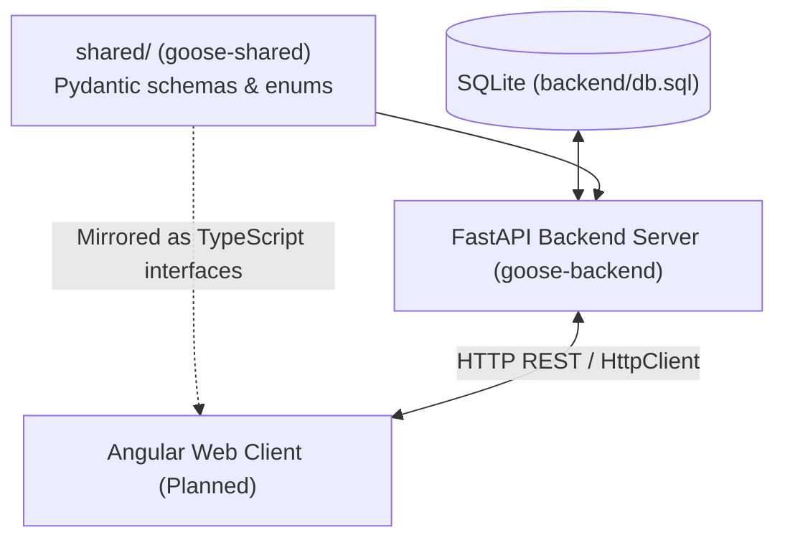

# Project Structure Specification: Goose

This document details the architecture and repository layout for the Goose application. **FastAPI** serves as the single source of truth for database access and business logic, with the upcoming **Angular Web App** (`web/`) acting as the client application consuming backend REST API endpoints.

---

## Workspace Directory Layout

```
goose/
├── docs/                      # Architectural & design specifications
│   ├── API_DESIGN.md          # REST API endpoints, schemas, and sync specifications
│   ├── DATABASE_DESIGN.md     # Relational schema, ER diagram, and SQLite configuration
│   ├── PROJECT_STRUCTURE.md   # System architecture and workspace layout (this document)
│   ├── TODO_EARNINGS_AND_ANALYST_RATINGS.md # Temporary feature backlog for sentiment tracking
│   └── CODE_REVIEW.md         # Historical backend audit and technical debt log
│
├── shared/                    # Shared Python package (goose-shared)
│   ├── shared/
│   │   ├── schemas/           # Pydantic response/request models
│   │   │   ├── stock.py       # StockBaseSchema, StockCreateRequest, StockResponse
│   │   │   ├── price.py       # StockPriceResponse, StockChangeResponse
│   │   │   ├── dividend.py    # StockDividendResponse, StockDividendCreate
│   │   │   └── sync.py        # StockSyncResult, StockSyncSummary
│   │   ├── enums.py           # Shared enumerations (Exchange, Currency, etc.)
│   │   └── __init__.py
│   └── pyproject.toml         # Package definition (name: goose-shared)
│
├── backend/                   # FastAPI REST API & Database server (goose-backend)
│   ├── app/                   # Server codebase
│   │   ├── api/               # API router and endpoints (/api/v1/stocks)
│   │   ├── core/              # Global configuration & SQLite database engine
│   │   │   ├── config.py      # Env vars & settings (DATABASE_URL, SQL_ECHO, etc.)
│   │   │   ├── database.py    # Engine (WAL mode, busy timeout) & get_db generator
│   │   │   └── market.py      # Timezone-aware exchange trading hours & status checks
│   │   ├── crud/              # Database operations (crud/stock.py)
│   │   ├── services/          # Business logic & integrations
│   │   │   └── stock_sync.py  # Vectorized incremental yfinance batch pipeline
│   │   └── main.py            # FastAPI entry point & ASGI config
│   ├── migrations/            # Alembic migration scripts
│   ├── alembic.ini            # Alembic configuration
│   ├── models.py              # SQLModel table definitions (Stock, StockPrice, StockDividend)
│   ├── dependencies.py        # Re-export compatibility layer
│   ├── db.sql                 # SQLite database file (server-only, not shared at root)
│   ├── pyrightconfig.json     # Subproject Pyright configuration
│   └── pyproject.toml         # Backend deps (fastapi, sqlmodel, yfinance, alembic, goose-shared)
│
├── web/                       # Angular Web Application (Planned Client)
│   ├── src/
│   │   ├── app/
│   │   │   ├── components/    # Reusable Angular components (charts, tables)
│   │   │   ├── services/      # Angular services (API calls via HttpClient)
│   │   │   └── models/        # TypeScript interfaces mirroring shared schemas
│   │   └── assets/
│   ├── angular.json           # Angular build configuration
│   ├── package.json           # Node dependencies
│   └── README.md
│
├── typings/                   # Local typing stubs for untyped libraries (yfinance)
├── .zed/settings.json         # Zed IDE workspace settings (Pyright extraPaths)
├── pyrightconfig.json         # Root Pyright static analysis configuration
├── pyproject.toml             # uv workspace root — declares all workspace members
├── uv.lock                    # Single shared lock file for all Python packages
├── Makefile                   # Convenience commands to run backend and backup
└── README.md                  # Project overview
```

---

## Architectural Workflow



### 1. Shared Package (`shared/`)
- Contains **Pydantic schemas** (API request/response models) and **enums**.
- Managed as a **uv workspace member** (`goose-shared`).
- The backend uses these schemas as FastAPI response models.
- When building the Angular frontend, `shared/shared/schemas/` serves as the **source of truth** for writing matching TypeScript interfaces.

### 2. Database & Server (`backend/`)
- **FastAPI** is the **exclusive** manager of `db.sql`.
- `db.sql` lives inside `backend/` — it is a server implementation detail; clients never connect directly.
- `core/config.py` reads `DATABASE_URL` and `SQL_ECHO` from environment variables.
- `core/database.py` creates the engine with WAL mode and busy timeout.
- `core/market.py` provides timezone-aware session status for Thai and US exchanges.
- `services/stock_sync.py` executes batched, vectorized yfinance downloads to minimize network requests.
- The server runs as an independent process: `uvicorn app.main:app --reload`.

### 3. Angular Web Client (`web/`, Planned)
- Built with **Angular**, communicates with the backend using `HttpClient`.
- TypeScript `models/` mirror the `shared/shared/schemas/` Pydantic models for end-to-end type safety.
- Utilizes modern browser charting (e.g. TradingView Lightweight Charts) for interactive financial time-series visualization.
- CORS is configured on the FastAPI server to allow requests from the Angular development server.

---

## uv Workspace Setup

A single `pyproject.toml` at the root declares all Python packages as workspace members. uv handles dependency resolution across all of them with one shared `uv.lock` file.

```toml
# goose/pyproject.toml  (root)
[tool.uv.workspace]
members = ["shared", "backend"]
```

```toml
# goose/shared/pyproject.toml
[project]
name = "goose-shared"
version = "0.1.0"
requires-python = ">=3.12"
```

```toml
# goose/backend/pyproject.toml
[project]
name = "goose-backend"
dependencies = [
    "goose-shared",   # resolved from workspace automatically
    "fastapi[standard]",
    "sqlmodel",
    "yfinance",
    "alembic",
]
```

---

## Root `Makefile`

```makefile
.PHONY: backend web sync lint backup

sync:
	uv sync

backend:
	cd backend && uv run uvicorn app.main:app --reload

web:
	cd web && ng serve
```

---

## Advantages of this Structure

| Concern | Approach |
|:---|:---|
| **Single source of truth for DB** | Only `backend/` touches `db.sql`. |
| **Single source of truth for API contract** | Pydantic schemas live in `shared/`, mirrored to TypeScript interfaces in `web/`. |
| **Lean dependencies** | Each package has its own `pyproject.toml`. |
| **One lock file** | uv workspace manages a single `uv.lock` at the root. |
| **API-first development** | Backend endpoints are fully defined and tested via OpenAPI/Swagger before frontend integration. |
| **Portability** | `DATABASE_URL` in `core/config.py` makes DB backend swappable (SQLite $\rightarrow$ PostgreSQL). |
| **Developer experience** | `Makefile` provides simple `make backend` and `make backup` commands. |
