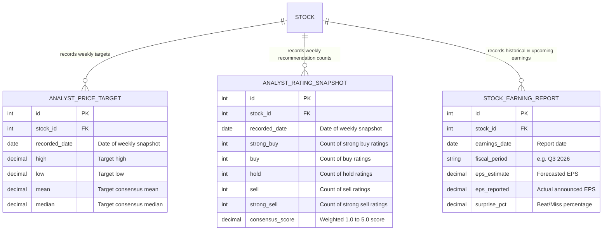

# [TODO / TEMPORARY] Earnings & Analyst Ratings Tracking Specification

> [!WARNING]
> **Temporary Design Document**: This document outlines the schema, data extraction, and tracking logic for analyst consensus revisions and earnings forecast changes. 
> Once the feature implementation (database tables, sync pipeline, API endpoints, and UI views) is fully complete and merged, **this document should be deleted**.

---

## 1. Objectives

Track **temporal revisions** (changes over time) of institutional analyst price targets, recommendation ratings, and quarterly corporate earnings estimates to generate actionable buy/sell signals:
1. **Target Price Momentum**: Detect when consensus price targets are being revised upwards (bullish) or cut (bearish).
2. **Rating Migrations**: Track shifts in recommendation breakdown (e.g. upgrades from *Hold* to *Buy*).
3. **Earnings Estimate Revisions**: Track consensus EPS revisions leading up to quarterly reporting dates, and record actual earnings surprises.

---

## 2. Available Data from `yfinance.Ticker`

### A. Analyst Price Targets (`ticker.analyst_price_targets`)
Returns consensus target prices:
```python
{
    'current': 235.50,
    'low': 185.00,
    'high': 300.00,
    'mean': 246.30,
    'median': 248.00
}
```
* **Database mapping**: Matches the existing [`AnalystPriceTarget`](file:///home/tam/github/goose/backend/models.py#L168-L183) table in `backend/models.py` (`high`, `low`, `mean`, `median`, `date`).

---

### B. Recommendations & Ratings (`ticker.recommendations_summary`)
Returns analyst consensus rating distribution across historical months:
```python
# DataFrame columns:
# - period: '0m' (current), '-1m' (last month), '-2m', '-3m'
# - strongBuy: int
# - buy: int
# - hold: int
# - sell: int
# - strongSell: int
```
* **Derived Metrics**:
  * Consensus Score = $(5 \times \text{StrongBuy} + 4 \times \text{Buy} + 3 \times \text{Hold} + 2 \times \text{Sell} + 1 \times \text{StrongSell}) / \text{Total}$
  * Rating Change = Current Consensus Score $-$ Previous Week's Score.

---

### C. Earnings Estimates & Surprises (`ticker.earnings_dates`)
Returns historical and forward reporting dates with consensus EPS estimates and actual reported figures:
```python
# DataFrame columns:
# - Earnings Date: Timestamp
# - EPS Estimate: float | None (analyst consensus expectation)
# - Reported EPS: float | None (actual announced EPS)
# - Surprise(%): float | None (percentage beat or miss)
```

---

## 3. Proposed Database Schema (For Next Phase)

When we implement this feature, we will need historical snapshot tables to track changes over time:



---

## 4. Planned API Endpoints

| Method | Route | Description |
| :--- | :--- | :--- |
| `GET` | `/api/v1/stocks/{identifier}/targets` | Historical analyst price targets and latest revision delta |
| `GET` | `/api/v1/stocks/{identifier}/ratings` | Historical analyst recommendation breakdown & upgrades/downgrades |
| `GET` | `/api/v1/stocks/{identifier}/earnings` | Earnings calendar, forward quarterly estimates, and surprise history |
| `POST` | `/api/v1/stocks/sync/fundamentals` | Trigger weekly batch refresh of fundamentals & analyst data |

---

## 5. Deletion Checklist

Before deleting this file, ensure:
- [ ] Database tables (`AnalystPriceTarget`, `AnalystRatingSnapshot`, `StockEarningReport`) migrated and active in SQLite.
- [ ] Weekly synchronization worker implemented in `backend/app/services/`.
- [ ] API routes implemented under `/api/v1/stocks/...`.
- [ ] TUI or Web client displays target momentum and upcoming earnings dates.
- [ ] Permanent architecture notes migrated into `DATABASE_DESIGN.md` and `API_DESIGN.md`.
